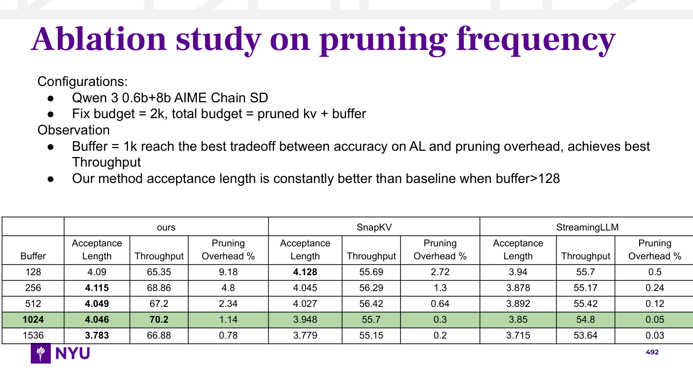
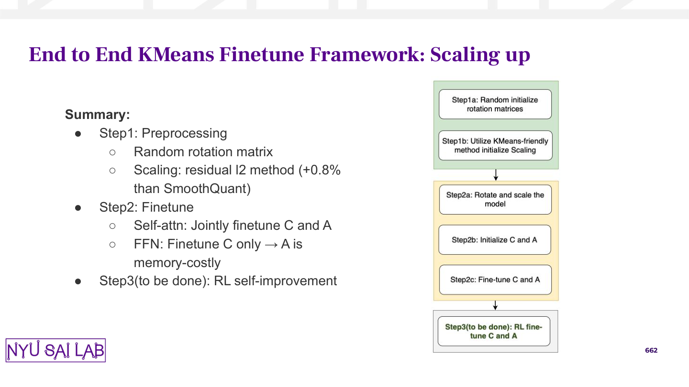
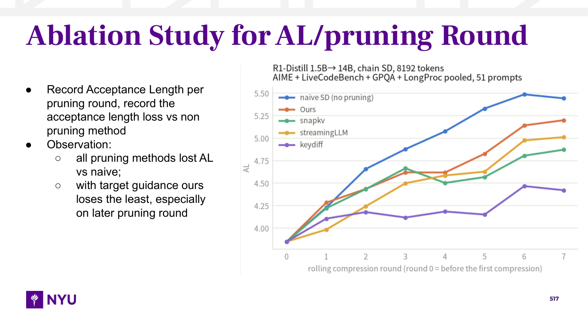
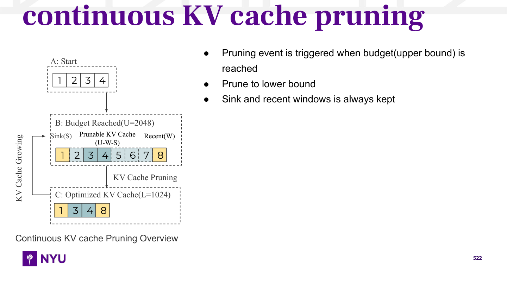
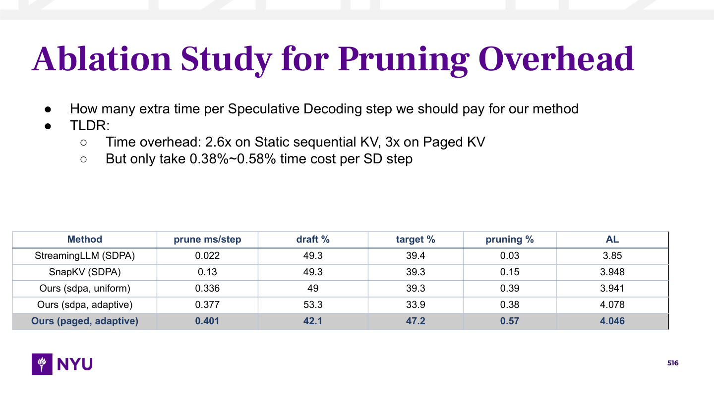
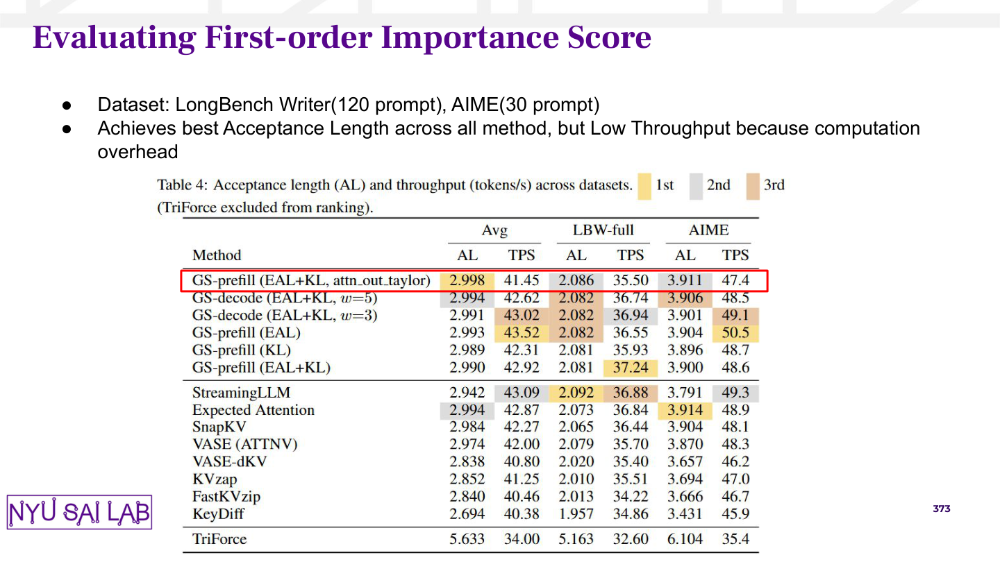
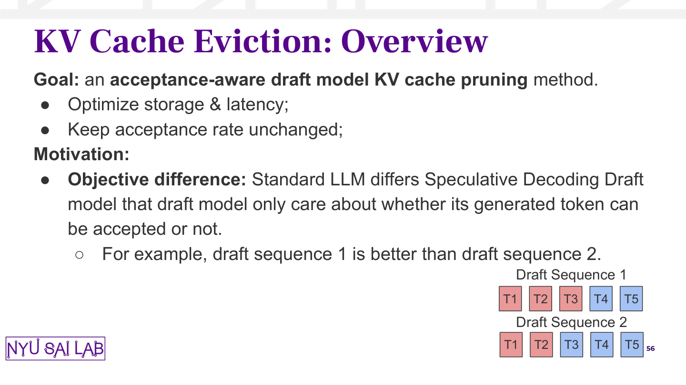

# Measured local author families

These are observed composition specifications, not a generic slide-design workflow. Choose the actual functional family before authoring using the [purpose-first selector](layout/family-selector.md). Report intent and current local series come before evidence form; composition and copy grammar are separate choices. Current user/deck identity controls the footer, regardless of the selected reference's observed chrome. `example-10` and `example-11` are former development cases G/H, now authorized training examples. They can support new work but cannot count as unseen evaluation again. No target experiment text or values are reusable.

Layout stage: shortlist compatible references from the compact science-free [family inventory](author-examples/family-inventory.json), which exposes purpose, evidence form and coupled body/object hierarchy across all23 examples. Then inspect the selected full-page image and [layout starters](author-examples/author-family-layouts.json), or the separately indexed [focused starters](author-examples/focused-layout-starters.json) for plot-led observations, compact scientific objects, runtime focus tables, evidence-led short readouts and prose-led overviews with insets. These starters contain geometry, typography, palette, grouping and footprint without scientific copy. Copy stage: use the already selected family and [copy records](author-examples/author-family-copy.json). Full span/baseline provenance lives in [G/H measurements](author-examples/measurements-gh.json); keep that verbose source out of the layout stage unless a measurement needs checking. All coordinates/font sizes are points on720×405; CSS px uses a4/3 multiplier.

## Variation is functional, including within the same font system

A conservative per-page census analyzed1,375 of the1,663 archive pages after133 range exclusions and155 lexical/manual quarantines; exact excluded-image/native-text fingerprint checks found no additional matches outside the ranges. These are descriptive counts of the permitted subset, not archive-wide prevalence or recommended defaults. A large upper native-span heuristic detected36pt purple Frank Ruhl Libre Bold on390 pages,27pt on148,28pt on114,29pt on102,24pt on82 and23pt on67. Separate body-region Arial-span majorities detected14pt black on267 pages and14pt gray on237, with real18/16/15/17pt gray families on90/68/54/38 pages. These heuristics do not distinguish every caption, diagram or body span semantically; selected-page native measurements remain the execution authority.

Native black9/10pt scientific labels are frequent, while ordinary14pt notes coexist with those smaller tables and plots. Black/sans scientific captions and decimal/lettered method outlines are legitimate author families. The census detected106 pages with numbered-outline syntax; scientific formatting remains independent of shared deck fonts/chrome. Size and palette alone do not identify scientific object role. Do not average these distributions into a universal title, body size, table theme or diagram orientation.

## Broad functional prototypes: examples17–22

| Scientific role | Coupled observed hierarchy | Focused guide |
|---|---|---|
| Algorithm premise and operational report with supporting empirical panels and illustration |17:27pt topic /14pt gray narrative; independent plot captions12.35pt, local sample illustration11pt. Narrative hierarchy remains primary. |[Method reports](layout/method-report.md) |
| Paper-reading conceptual method outline with equations |18:23pt topic /14pt black decimal-letter outline at16.8pt pitch; complete independent equation excerpt below. |[Method reports](layout/method-report.md) |
| Pure scientific table readout with local caption |19:35pt topic /10pt Montserrat context /8pt black native table; neutral gray grouped headers and condition stubs. |[Scientific tables](layout/scientific-table.md) |
| Empirical design notes with independent plot and math objects |20:36pt topic /14pt black notes at19.32pt pitch; right plot panel35.4% canvas area, separate equation under notes. |[Independent plots](layout/independent-plot-setup.md) |
| Actual operator/dependency graph beside framework report |21:22pt topic /14pt gray narrative; compact vertical graph14.7% area and local9pt native key; graph/math typography independent. |[Operator graph](layout/operator-graph.md) |
| Ordered implementation procedure as the scientific object |22:22pt topic /18pt numbered stages /14pt lettered details; no compulsory separate diagram. |[Method reports](layout/method-report.md) |

Inspect their linked full-page images from the [inventory](author-examples/family-inventory.json). [Broad measurements](author-examples/measurements-broad.json) contain verbatim source evidence separately from [science-free starters](author-examples/focused-layout-starters.json). All six are permanent training references. A method explanation may remain an ordered narrative, conceptual outline, or report with supporting inset; only genuine dependency structure selects an operator graph. Scientific tables keep their current grouping, caption and emphasis semantics rather than inheriting one example's green composition. Change body scale and evidence footprint together when adapting; preserve scientific truth and repair source clipping narrowly.

Example23 adds a confirmed black/sans primary scientific-heading variant:14pt black Arial Bold method/model/conditions caption, ordinary10pt gray Montserrat implementation/pending notes at12pt pitch, and a neutral8pt native Arial table. No additional purple topic title is present. This one known-development page was admitted separately after the broad census, without changing its descriptive counts. Inspect [scientific status caption](layout/scientific-table.md) and its science-free record; it is one legitimate local family, not a universal default. Actual science and status determine current slots.

## Wide ablation sweep: example-10 / development G

Use when a controlled knob is swept across methods and several metrics, with setup/observation above a broad results table. This is a sibling of example-07, not permission to give every ablation the same table dimensions.

| Layout token | Observation |
|---|---|
| Title | Frank Ruhl Libre Bold36pt, #57068C; first glyph x31.29,y17.54. Large experiment-type topic, one line in this example. |
| Narrative | Arial14pt black; glyph envelope x38.75–679.17,y78.72–193.52. Plain standalone roles, not bold labels. |
| Bullet geometry | Large filled `●`, marker x48.30; text x74.75; hanging26.45pt. Continuous16.8pt baseline pitch; wrap stays at text x. |
| Evidence | Native black-grid table x2.16–722.16,y225.91–357.91. Two header rows19.5/30pt, data rows16.5pt; Arial10pt, ordinary weight including header text. Method spanners above repeated metric columns. |
| Palette / emphasis | White header/body; black .75pt rules; selected operating row #B6D7A8. Bold primary comparison winner within each condition plus reported headline throughput point. Selection and metric winning are different semantics. |
| Footprint | Narrative envelope25.2% of canvas; table32.6%; envelope ratio≈0.77. Narrative-to-table gap32.39pt. NYU footer. |

Keep the near-full-width low table and ordinary report above it. The observed source outer rule extends2.16pt beyond the canvas; a minimal border correction is a true defect repair, not grounds for a wholesale margin/font redesign. Full metric names and multi-line headers are family evidence; replacing every familiar label with an abbreviation changes its table silhouette. Preserve complete scientific tokens and figures. A result table can end the page without a conclusion, caption essay or acronym key.

Copy evidence is separate: two configuration bullets, a plain observation role, two observation bullets with one wrapped continuation. This connected ordinary flow is different from one bold lead-in per bullet or an isolated takeaway. Use supplied facts and scope; never manufacture awkward grammar.

## Working summary plus vertical inset: example-11 / development H

Use when the slide reports staged implementation/progress and the workflow is a compact, independently styled scientific figure. Example-01 is a supporting report-plus-inset analogue; it does not force this exact inset width for every mechanism.

| Layout token | Observation |
|---|---|
| Title | Frank Ruhl Libre Bold22pt, #57068C; first glyph x29.79,y42.88. This family has a modest topic title, not a36pt ablation heading. |
| Narrative | Source text frame x61.03–392.73,y104.53–313.06; Arial14pt #333333. Standalone bold Summary; remaining text ordinary. |
| Bullet geometry | Level0 marker/text x77.33/103.78; level1 x113.33/139.78; filled `●` then hollow `○`;36pt level increment,26.45pt hanging. Continuous19.32pt pitch, including wraps. |
| Figure | Vertical source image x442.75–589.07,y80.27–374.39; width146.32,height294.12. Source is296×595 raster; labels estimated7.4–8.4pt, not extracted font measurements. |
| Group grammar | Two operation boxes in first pastel group; three in next; one pending operation in final neutral group. Thin black arrows between groups. Rounded white operation boxes inside rectangular stage backgrounds. |
| Palette | Approximate raster interior fills #CFE5D0 / #FFF0C7 / #F3F3F3; white operations, thin dark outlines. Final label bold dark olive. Explicit pending wording; no red dashed treatment. |
| Footprint | Narrative frame23.7% of canvas, figure14.8%, ratio≈1.61; figure20.3% of canvas width. Frame gap50.02pt. SAI footer. |

Retain the asymmetric report-plus-inset composition and the figure's own visual language. Uniform horizontal stages, a larger bottom workflow, repeated red pending cues, and generic gray cards can improve usability preference while making authorship easier to distinguish. Sharpen labels and connectors at the local scale before changing orientation or making the diagram a hero. Small recoverable labels are not automatically a defect. Never preserve missing/clipped scientific text or make labels smaller to imitate roughness.

The inset font is **not** recovered from PDF text: the source is raster. The detailed JSON records native text measurements separately from image-based estimates. Exact original diagram font and vector stroke widths remain unknown. [Inset detail](author-examples/example-11-workflow-detail.png) is inspection evidence, not an asset to insert in a new slide.

## Plot-led runtime observation: example13

Use when a scientific trend/ablation plot carries the conditions and main evidence while notes give a short recording purpose and scoped observations. The source has a36pt Frank Ruhl Libre Bold title in the current experiment-series naming rhythm, ordinary14pt Arial notes at16.8pt pitch, and a dominant plot x294.17–707.67,y78.87–336.63pt. That plot occupies57.4% of page width and36.6% of area. Notes are narrow at left with marker/text x30.75/57.20 and nested66.75/93.20pt. They use a purpose bullet and plain Observation with hollow nested observations, rather than a subtitle and expanded Goal/Experiment/Results account.

Reserve the scientific plot before composing notes. Keep its entire conditions/title, axes, legend and current curves. Source plot labels are raster; their nominal fonts are unknown. Surrounding fonts/geometry are exactly measured native text. The fuller curve-report family09 remains legitimate when current report intent and series need its sections. Plot presence alone cannot choose between these families. [Focused module](layout/plot-led-observation.md).

## Compact independent scientific object plus notes: example14

Use for one self-contained mechanism with brief adjacent working notes. The source has one compact left scientific object, three short operational bullets at upper right and a short local caption below the object. The measured diagram envelope x21.12–257.85,y81.92–318.23pt is19.2% of the page. Notes use Arial14pt at21.84pt pitch; the caption is Arial13pt. The local lowercase topic title is Frank Ruhl Libre Bold42pt. Its extracted font envelope extends above canvas, while visible ink differs from that envelope; inspect rendered ink and repair actual clipping narrowly.

The figure is native PDF text/vector, **not** a raster-font estimate. Its local labels are Times New Roman12pt state/operation,10pt region labels, and Montserrat14pt item IDs. Dark gray.75pt state outlines have3/2.25pt dashes. Scientific roles use yellow boundaries, darker cyan selected interior and lighter cyan other interior, with solid/dashed cell outlines. These roles and exact local font measurements support coherent native reconstruction without homogenizing figure text into deck prose.

Keep one primary mechanism and its necessary annotations. A symbolic relation and a concrete illustration do not automatically justify two parallel diagrams, a full-body teaching layout or a guardrail footer. New content determines actual topology and labels; source values and counts are never defaults. [Focused module](layout/compact-object.md) and [detail image](author-examples/example-14-object-detail.png).

## Runtime focus table: example12

Use for a bounded runtime-cost report plus selected configuration. The local source uses a36pt Frank Ruhl Libre Bold experiment-series title,14pt ordinary question/compact-summary notes with nested observations, and a low wide10pt Arial table. Its frame x12.74–674.24,y234.03–333.03pt is91.9% of page width and22.5% of area. Row height is16.5pt, with≈65.92pt between last note glyph and table. Preserve this readable density and deliberate gap when current facts fit.

White cells, navy bold headers, pale blue.75pt rules and a gray/navy-bold focus row are this local variant. The focused row contains nonwinning values. Focus configuration, scientifically justified winner cells and header styling are independent controls; do not infer winners from row fill or automatically emphasize all extrema. Existing plain black and green-operating-row families remain legitimate. Current series can justify compact question/summary cadence instead of universal Question/Observation labels. [Focused module](layout/runtime-focus-table.md).

## Evidence-led short readout: example15

Use when a brief experimental context and scoped observation accompany one complete scientific evidence figure. The source has a24pt Frank Ruhl Libre Bold evaluation topic, ordinary14pt black Arial notes at16.8pt pitch in a shallow full-width top band, and a dominant independent paper-table figure below. Its frame x108.49–568.61,y113.89–405pt covers63.9% of page width and45.9% of area. The image is991×627 landscape raster; its serif label fonts are not native measurements. The source figure carries its own caption, exclusion, key, panels and rows. A separate red1.5pt native outline marks the focused row without changing embedded ranking colors.

Keep body size, report band and evidence footprint coupled. Dense table typography does not establish surrounding note size. The source frame reaches the canvas bottom; inspect actual caption/rule ink and minimally contain evidence if current footer clearance requires it. Two short report roles do not authorize a multi-sentence sidebar account. Preserve the necessary scientific scope and reported causal status within concise prose/evidence witnesses. [Focused module](layout/evidence-led-readout.md), [evidence detail](author-examples/example-15-evidence-detail.png).

## Prose-led overview with supporting inset: example16

Use when the intended objective and rationale lead the page and a schematic supports a nested motivation example. The source has a36pt topic overview title and19pt gray Arial narrative at26.22pt pitch. Its hierarchy combines an inline objective role and bold scientific subject, brief objective list, motivation role, connected objective-difference bullet and hollow nested example. Main marker/text x41.59/71.06pt; nested77.59/107.06pt. Narrative spans x35.06–680.75,y75.15–277.69pt.

The independent native inset x523.94–675.15,y282.60–375.49pt is21.0% of page width and4.8% of area. Exact local fonts are Arial13pt item labels and15pt row labels. Square-corner cells23.43×25.84pt use.75pt #333333 outlines and local #EA9999/#A4C2F4 semantic fills. This small illustration belongs to the nested example. Preserve its compact scale and grammar rather than expanding it into a rounded comparison board with repeated row explanations, legend and takeaway. Add a minimal necessary state key when current prose and shapes leave a mapping ambiguous. Every current relation and token position must remain explicit; a goal stays aspirational. [Focused module](layout/prose-led-overview.md), [inset detail](author-examples/example-16-inset-detail.png).

## Promoted-reference index and provenance

| New training image | Authorized source | Function |
|---|---|---|
| example12 | PDF3 page516, former old test C | Runtime focus table and compact report cadence |
| example13 | PDF3 page517, former old test F | Dominant plot with brief purpose/observations |
| example14 | PDF3 page522, former old test I | One independent scientific object with short notes |
| example15 | PDF3 page373, former old test M | Brief top report with dominant independent evidence |
| example16 | PDF3 page56, former old test N | Large objective/motivation narrative with small supporting inset |

PDF3 is `Cerebras & NYU Weekly Speculative Decoding 2026 Spring .pdf`. These pages are now explicitly authorized **development/training resources**, alongside the existing11 references. Examples15/16 and their four locked R400/R413/R427/R440 reviews are also explicitly promoted development/training evidence; they cannot be held out again. Old R300/R313/R327/R340 feedback and revisits inform narrower families and cannot count as fresh validation. [Raw native measurements/provenance](author-examples/measurements-cfi.json) separate actual fonts/geometry/vector colors from raster pixel estimates. [Science-free focused starters](author-examples/focused-layout-starters.json) index images, independent emphasis controls and executable geometry; experiment values remain outside starters. [M/N native spans, image/vector geometry and provenance](author-examples/measurements-mn.json) separately record the later training sources; source15 scientific labels are raster and source16 labels native. No future or neighboring source pages were used to build these resources.

## Select among the existing families, do not average them

| Reading task | Actual local references | Distinguishing execution choice |
|---|---|---|
| Idea/report beside a mechanism figure |01;11 when staged progress dominates|01 uses22pt title/17pt prose and large independently drawn inset;11 uses22/14 with narrower vertical inset. |
| Dense result table with little prose |02|27pt title,10pt table, grouped gray headings; the table itself supplies much of the explanation. |
| Experimental setup/results plus table |03|25pt title,13pt report,10pt table; local comparison-cell color and gray structure. |
| Factorization / aligned mathematical objects |04|36pt title,12–18pt labels, native matrices; no compulsory summary/table wrapper. |
| Positional worked transformation |05|30pt title;10–16pt labels, channel/state alignment and arrows. |
| System diagnostic |06|24pt long title,14pt report,10pt complete evidence table; ordering follows the diagnostic comparison. |
| Compact budget/runtime ablation |07|36pt title,14pt plain/nested report,10pt table; meaningful whitespace and its exact emphasis variant. |
| Untitled working mechanism |08|No invented title, object/math8–11pt, sparse native schematic. Do not add a systematic object-label/connector layer merely because a helper provides it. |
| Goal/experiment/results with scientific curves |09 when current purpose/series supports fuller sections|29pt title,14pt report, selective red phrase emphasis; intact evidence panel. |
| Wide multi-method sweep |10|36/14/10; plain roles, full-width low table, white/black palette with green operating row. |
| Staged progress report with compact workflow |11|22/14; bold Summary then ordinary nested steps, narrow independent pastel inset. |
| Brief runtime observation with dominant scientific plot |13|36/14; narrow plain purpose/Observation notes, large intact plot, no imported section taxonomy. |
| One compact scientific object with short notes |14|42/14/13; exact local serif figure labels and Montserrat IDs, dashed states and semantic fills; one mechanism. |
| Runtime comparison with a focused configuration |12|36/14/10; compact question/summary, low wide blue/gray table, focus and winning semantics independent. |
| Brief experimental readout with dominant independent evidence |15|24/14; shallow full-width ordinary report above complete scientific figure, optional separate local focus annotation. |
| Intended objective and motivation with a supporting schematic |16|36/19; large connected narrative and nested example, compact lower-right native inset with13/15pt local labels. |

The earlier exact spans and paragraph geometry remain in `author-examples/measurements.json`, `measurements-summary.json` and `paragraph-tokens.json`. A family choice should identify its actual reference and its title/body/evidence sizes, grouping and footprint. “Same author style” alone does not identify an executable family.

## Evaluation boundary

R200/R213 distinguished authorship despite often preferring generated alternatives: added local diagram labels, compact acronym headers, navy/pale-blue replacement styling and rewritten report flow were usability benefits but attribution cues. R231/R246 both guessed the H original at0.76 while preferring the alternative; the positive original evidence was large nested summary plus smaller independently styled pastel vertical figure. These development judgments motivate matching functional grammar, not replicating roughness or treating reviewers' readability preferences as acceptance.

A genuine scientific or rendering defect should be repaired narrowly. New explanatory layers, generic normalization, enlarged labels, standardized diagram orientation, uniform table themes and polished prose require evidence from the selected family or the current user request. Preserve facts, explicit pending status and scoped claims. These training pages and old reviews establish no fresh indistinguishability result.

The later locked R400/R413/R427/R440 judgments likewise distinguish a short experimental readout from a small-type evidence/sidebar report and distinguish a prose-led motivation page from an enlarged teaching inset. The v8 packets had already narrowed their analogues to dense-result02 and idea-plus-mechanism01 before the fresh layout owners reasoned about object roles. M then inherited10pt deck notes despite needing only concise context/observation; N assigned repeated legend/comparison roles to a supporting sketch. The correction is role-aware candidate selection and coupled narrative/object scale, not a rule that all tables sit below notes or all diagrams remain small. Scientific scope fixes stay mandatory: do not copy overbroad original claims or remove required comparison/exclusion/attribution facts to match the source's brevity.
