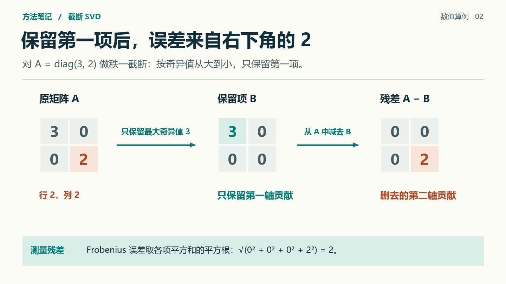
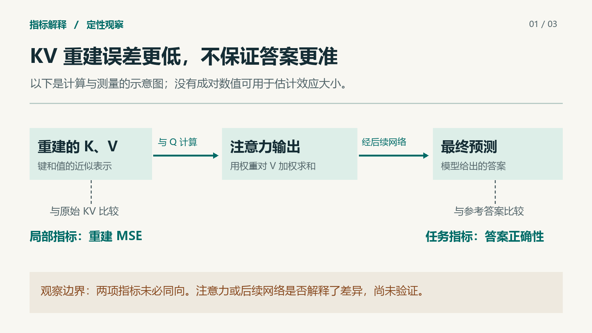

# 科研机制图与跨页叙事：容易画错的例子

按当前故障选一行。数字都是由定义直接复算的教学算例。画真实实验时换用当前材料，不沿用这些结论。

## 一条箭头到底传什么

| 科研例子 | 主图怎么画 | 怎样查错 |
|---|---|---|
| KV 重建和任务表现 | 主链从重建的 K、V 到注意力输出、后续预测和答案。由原始与重建 K、V 引出比较支线，答案和参考标签汇入评分节点。 | 顺着主链读一遍。若某步读成“把均方误差传给注意力”，应移开指标并改连线。 |
| 温度缩放 | 从 logits 除以正温度后得到概率，再分叉到 argmax 预测与基于真值标签的负对数似然。给同一样本并排画两种温度。 | 类别相同可以有不同损失。把准确率连进损失函数会画出错误依赖。注明本例为冻结模型推理。 |
| 训练与推理 | 同一模型可在推理页读出损失，在训练页沿损失梯度更新参数。另用时间标记表明更新后的参数供下一步使用。 | 箭头的方向取决于本页阶段；“指标总是旁路”同样会误导。 |
| 注意力对值误差的加权 | 固定权重，令值扰动为 (0,1)。两组权重 (0.9,0.1) 与 (0.1,0.9) 给出输出扰动 0.1 与 0.9，元素 MSE 均为 0.5。以共轴的两行对齐误差所在位置。 | 两组权重的集中程度相同，变化的是大权重的位置。该等式只覆盖权重固定的值扰动。 |

## 局部放大要展示一个可以核对的变化

| 科研例子 | 整体定位 → 局部视图 | 标题最多能说什么 |
|---|---|---|
| 块内正交旋转 | 在整体矩阵上选中一行的同一块；将二维向量 (2,0) 旋转到 (√2,√2)，两个面板共用纵轴。用同一约定标明行向量右乘或列向量左乘。 | 在这个方向与算例中分量更均衡，向量长度仍为 2。聚类结果需另行测量。 |
| 秩一截断 | 对角矩阵 diag(3,2) 的第二个奇异分量被截掉；在原矩阵和残差矩阵标出同一位置。 | 本例 Frobenius 范数误差为 2，误差平方为 4。保留秩与保留能量是两种量。 |
| 最近邻编码 | 数轴上标出输入、码字和被选中的位置。索引画在存储槽中，解码后回到数轴。 | 索引是地址；误差从原始值和重建值计算，不能拿索引与原始值相减。 |

## 让连续三页形成一个论证

用同一输入和码本走完“表示 → 行为 → 决策”。第一页从 x=1.6 得到索引 1 和重建值 2（码本为 0、2、5，从零编号）。第二页在同一数轴增加阈值 1.8。让原值和重建值各自通过同一决策规则，并与同一真值比较。第三页指出这个例子证明可能发生决策翻转；若要估计发生频率，需在目标样本集上统计。第三页的证据身份从算例变成评估计划，用动词明确区分。

换题检验可用“温度缩放 → 样本损失变化 → 如何在验证集评估校准”。第一页引入 logits 和温度；第二页沿用同一样本与真值；第三页用待测的群体指标说明还需什么证据。单样本概率或损失变化不足以断言总体校准改善。

每页增加一个可定位的新操作、新观测或新决定。把连续页面缩小并排，检查对象颜色与标签是否一致，读者是否需要在第二页重新寻找第一页的对象。若确实要换布局，用同一数值、符号和直接标签重新定位。

## 两张可对照的成片

读图任务：遮住标题，能否只凭三个对齐矩阵指出被删除的数在哪个位置、它对残差范数贡献多少？非对角矩阵的一般 SVD 应展示奇异方向；单元格定位仅适用于本算例。

读图任务：沿实线说出下一步收到什么，再沿虚线指出比较的两方。科研解释与效应大小分开检查。将该样式移到训练图时，重新确定目标函数是否经由优化器反馈到参数。
